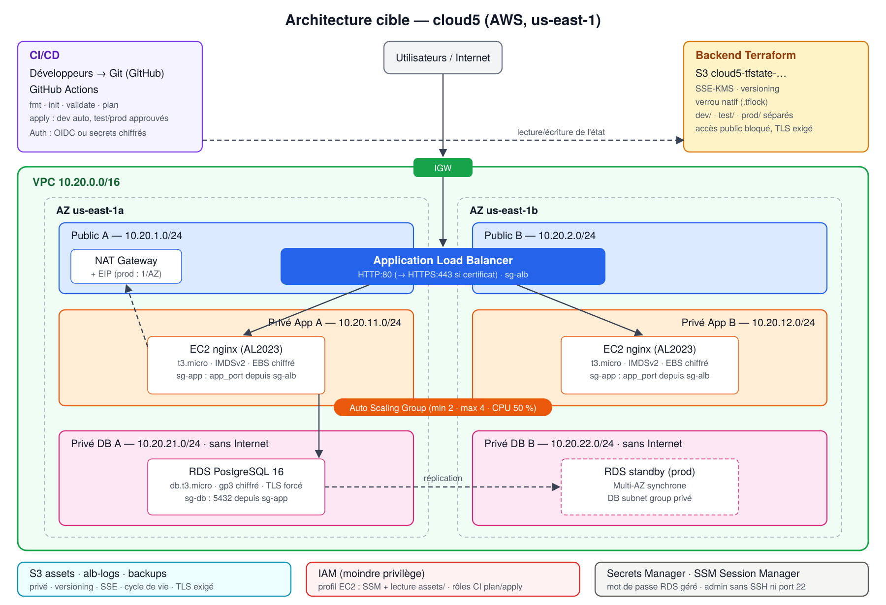

# terraform-cloud-project — Plateforme Web hautement disponible sur AWS avec CI/CD

Infrastructure **modulaire, sécurisée et reproductible** écrite en Terraform, déployée dans trois environnements (`dev`, `test`, `prod`) et validée par un pipeline **GitHub Actions** (`fmt → init → validate → plan → apply contrôlé`).



## 1. Architecture

| Couche | Ressources | Points clés |
|--------|-----------|-------------|
| Réseau | VPC `10.20.0.0/16` sur 2 AZ, 2 subnets publics, 2 privés App, 2 privés DB, IGW, NAT | DB sans aucune route Internet ; NAT unique (dev/test) ou par AZ (prod) |
| Exposition | Application Load Balancer, Target Group, health check `/health` | HTTP:80, HTTPS:443 + redirection si certificat ACM |
| Calcul | Launch Template (AL2023, IMDSv2, EBS chiffré) + Auto Scaling Group | min 2 / max 4, une instance par AZ, scaling CPU 50 %, remplacement auto des instances KO |
| Données | RDS PostgreSQL 16 dans un DB subnet group privé | non public, chiffré, TLS forcé, mot de passe dans Secrets Manager, Multi-AZ en prod |
| Stockage | Bucket S3 `assets/`, `alb-logs/`, `backups/` | privé, versioning, SSE, cycle de vie, TLS exigé |
| Identité | Profil EC2 (SSM + lecture `assets/`), rôles CI plan/apply (OIDC) | moindre privilège, aucun SSH |
| État | Bucket S3 `cloud5-tfstate-<compte>-<région>` | SSE-KMS, versioning, verrou natif `use_lockfile`, une clé par environnement |

Détails : [docs/architecture.md](docs/architecture.md) · Sécurité : [docs/securite.md](docs/securite.md) · Coûts : [docs/couts.md](docs/couts.md) · Tests : [docs/tests.md](docs/tests.md) · CI/CD : [docs/cicd.md](docs/cicd.md)

## 2. Organisation du dépôt

```
terraform-cloud-project/
├── .github/workflows/terraform.yml   # pipeline CI/CD
├── bootstrap/                        # bucket du backend (+ OIDC GitHub optionnel)
├── modules/
│   ├── network/        # VPC, subnets, IGW, NAT, routage
│   ├── security/       # Security Groups, rôle/profil IAM EC2
│   ├── load-balancer/  # ALB, listeners, target group, health check
│   ├── compute/        # Launch Template, user_data, ASG, scaling
│   ├── database/       # RDS, subnet group, parameter group
│   └── storage/        # S3, versioning, chiffrement, cycle de vie
├── environments/{dev,test,prod}/     # un état et des variables par environnement
├── scripts/deploy.sh                 # bootstrap + init + plan/apply/destroy
├── scripts/run-tests.sh              # tests obligatoires -> docs/test-results-<env>.md
├── docs/                             # schéma, sécurité, coûts, tests, CI/CD
├── terraform.tfvars.example          # modèle sans secret
├── .gitignore  ·  LICENSE  ·  README.md
```

Chaque module contient `main.tf`, `variables.tf` (typées, décrites, validées), `outputs.tf`, `versions.tf` et un `README.md` (entrées, sorties, exemple).

## 3. Prérequis

| Outil | Version |
|-------|---------|
| Terraform | ≥ 1.10 (verrou S3 natif `use_lockfile`) |
| AWS CLI | v2 |
| Compte AWS | standard **ou** AWS Academy Learner Lab (`us-east-1` / `us-west-2`) |
| Git + compte GitHub | pour le pipeline |

> **AWS Academy Learner Lab** : la création IAM y est interdite. Les `terraform.tfvars` fournis utilisent `create_iam_role = false` et le profil `LabInstanceProfile` du lab. Sur un compte standard, passez `create_iam_role = true`.

## 4. Authentification (sans secret en clair)

Les identifiants ne sont **jamais** écrits dans le dépôt ni dans un `.tfvars`. Au choix :

- **AWS CloudShell** (recommandé pour la démo) : la session de la console est utilisée directement.
- **Poste local** : `aws configure sso` / `aws sso login`, ou variables d'environnement de session :
  ```bash
  export AWS_ACCESS_KEY_ID=...  AWS_SECRET_ACCESS_KEY=...  AWS_SESSION_TOKEN=...   # Learner Lab : "AWS Details > Show"
  ```
- **Pipeline** : identité fédérée **OIDC** (rôles créés par `bootstrap/` avec `create_github_oidc = true`) ; à défaut (Learner Lab) secrets chiffrés GitHub `AWS_ACCESS_KEY_ID`, `AWS_SECRET_ACCESS_KEY`, `AWS_SESSION_TOKEN`.

## 5. Déploiement

### 5.1 Méthode rapide (script)

```bash
./scripts/deploy.sh dev plan      # bootstrap si besoin + fmt + init + validate + plan -> plan.txt
./scripts/deploy.sh dev apply     # applique le plan relu
./scripts/run-tests.sh dev        # tests obligatoires
./scripts/deploy.sh dev destroy   # destruction
```

### 5.2 Méthode détaillée

```bash
# 1) Backend (une seule fois)
cd bootstrap
terraform init && terraform apply
BUCKET=$(terraform output -raw state_bucket)

# 2) Environnement
cd ../environments/dev
terraform fmt -check -recursive ../..
terraform init -backend-config="bucket=$BUCKET" -backend-config="region=us-east-1"
terraform validate
terraform plan -out=tfplan && terraform show -no-color tfplan > plan.txt
terraform apply tfplan
terraform output alb_url

# 3) Destruction (obligatoire après la démonstration de test)
terraform destroy
```

## 6. Variables principales

| Variable | dev | test | prod | Description |
|----------|-----|------|------|-------------|
| `aws_region` | us-east-1 | us-east-1 | us-east-1 | Région |
| `environment` | dev | test | prod | Environnement (validé) |
| `vpc_cidr` | 10.20.0.0/16 | 10.30.0.0/16 | 10.40.0.0/16 | VPC (/16 validé) |
| `single_nat_gateway` | true | true | false | NAT unique / par AZ |
| `instance_type` | t3.micro | t3.micro | t3.small | Type EC2 |
| `min_size` / `max_size` | 2 / 4 | 2 / 4 | 2 / 6 | Capacité ASG |
| `db_instance_class` | db.t3.micro | db.t3.micro | db.t3.small | Classe RDS |
| `db_multi_az` | false | false | true | RDS Multi-AZ |
| `db_deletion_protection` | false | false | true | Protection RDS |
| `project_name` | cloud5 | cloud5 | cloud5 | Préfixe de nommage |

Convention de nommage : `<projet>-<environnement>-<ressource>` (ex. `cloud5-dev-alb`). Tags obligatoires via `default_tags` : `Project`, `Environment`, `Owner`, `ManagedBy = Terraform`.

## 7. Sorties

| Sortie | Usage |
|--------|-------|
| `alb_url` / `alb_dns_name` | Accès à l'application |
| `asg_name` | Tests de panne et de scaling |
| `db_endpoint` / `db_address` | Point de terminaison privé RDS |
| `db_secret_arn` | Secret des identifiants RDS |
| `bucket_name` | Bucket applicatif |
| `vpc_id`, `availability_zones` | Vérifications réseau |

## 8. Procédure CI/CD

| Événement | Jobs | Environnement |
|-----------|------|---------------|
| Pull Request vers `main` | fmt, validate, Checkov, **plan** des 3 env. commenté sur la PR | — |
| Push sur `main` | fmt, validate, plan, **apply automatique** | dev |
| `workflow_dispatch` | plan puis **apply/destroy après approbation manuelle** | test, prod |

Configuration GitHub : *Settings → Environments* : `dev`, `test` et `prod` (*Required reviewers* + *Deployment branches: main* sur test/prod) ; *Variables* : `TF_STATE_BUCKET`, `AWS_REGION`, et optionnellement `AWS_PLAN_ROLE_ARN` / `AWS_APPLY_ROLE_ARN` ; *Secrets* (si pas d'OIDC) : `AWS_ACCESS_KEY_ID`, `AWS_SECRET_ACCESS_KEY`, `AWS_SESSION_TOKEN`. Protéger `main` (PR + check `fmt & validate` obligatoires). Détails : [docs/cicd.md](docs/cicd.md).

## 9. Coûts et limites connues

Estimation `dev` ≈ **100 USD/mois soit ≈ 0,14 USD/heure** (NAT Gateway et ALB représentent plus de la moitié) ; `prod` ≈ **195 USD/mois**. Détail : [docs/couts.md](docs/couts.md).
**Détruire `test` (et `dev`) dès la fin de la démonstration.**

Limites : HTTPS requiert un nom de domaine et un certificat ACM ; Learner Lab (pas d'IAM ni d'OIDC, session de 4 h, secrets CI à renouveler à chaque session) ; une seule NAT en dev/test (perte de la sortie Internet des instances si l'AZ A tombe — le service web reste servi).

## 10. Dépannage

| Symptôme | Cause probable | Solution |
|----------|----------------|----------|
| `Error acquiring the state lock` | apply interrompu | Attendre ou `terraform force-unlock <ID>` après vérification |
| `ExpiredToken` / `InvalidClientTokenId` | session Learner Lab expirée | Redémarrer le lab, recopier les identifiants / secrets CI |
| `AccessDenied iam:CreateRole` | Learner Lab | `create_iam_role = false` |
| Cibles `unhealthy` | nginx pas encore installé, SG | Attendre 2-3 min ; vérifier `curl localhost/health` via SSM |
| `BucketAlreadyExists` | nom déjà pris | Le nom inclut le n° de compte ; changer `project_name` |
| RDS `deletion protection` au destroy (prod) | protection active | Passer `db_deletion_protection = false`, apply, puis destroy |
| `Unsupported Terraform Core version` | Terraform < 1.10 | Mettre à jour Terraform |
