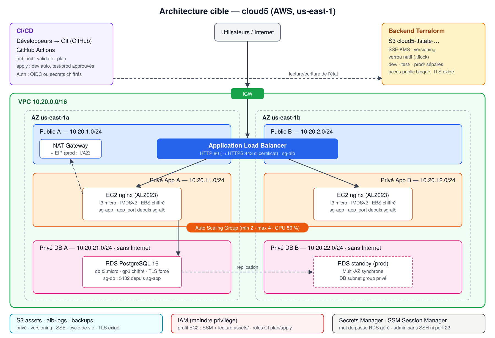
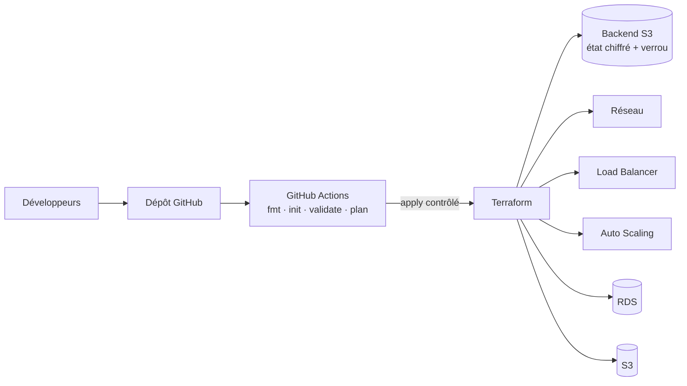
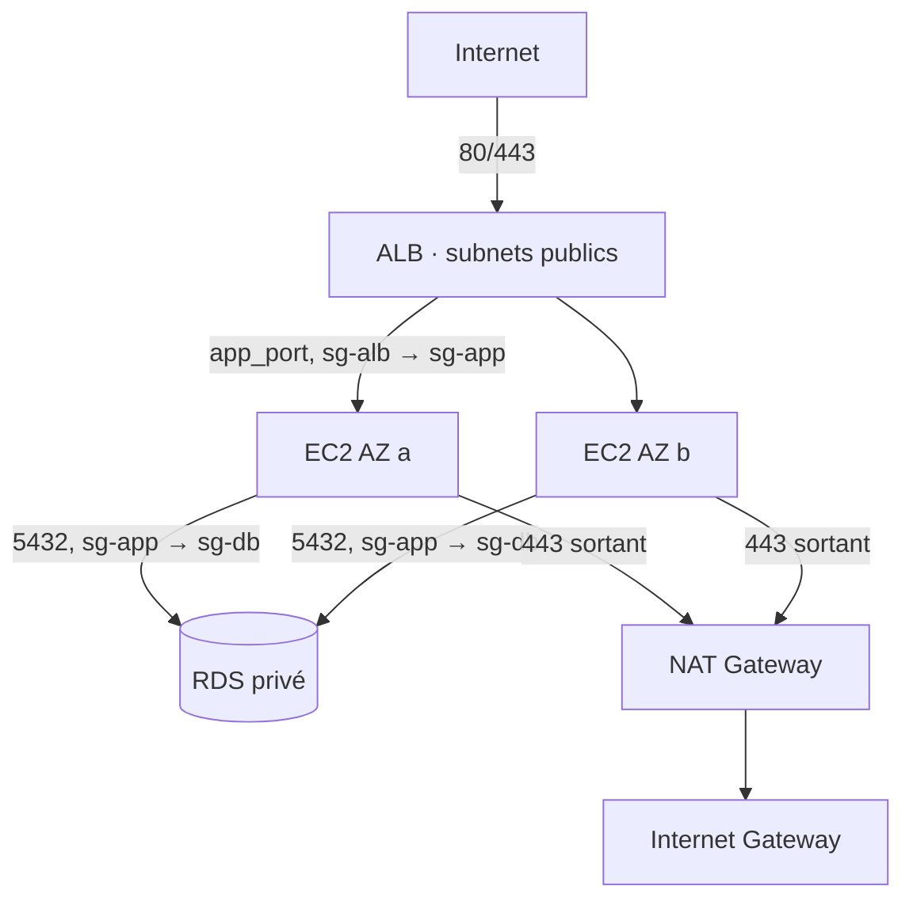

# Architecture



## Flux global



## Flux applicatif



## Plan d'adressage

| Composant | dev | test | prod |
|-----------|-----|------|------|
| VPC | 10.20.0.0/16 | 10.30.0.0/16 | 10.40.0.0/16 |
| Public A / B | 10.20.1.0/24 · 10.20.2.0/24 | 10.30.1-2.0/24 | 10.40.1-2.0/24 |
| Privé App A / B | 10.20.11.0/24 · 10.20.12.0/24 | 10.30.11-12.0/24 | 10.40.11-12.0/24 |
| Privé DB A / B | 10.20.21.0/24 · 10.20.22.0/24 | 10.30.21-22.0/24 | 10.40.21-22.0/24 |

Les sous-réseaux sont **dérivés** du CIDR du VPC (`cidrsubnet(vpc_cidr, 8, n)`) : changer `vpc_cidr` suffit à renuméroter un environnement sans conflit en cas de peering futur.

## Tables de routage

| Table | Route 0.0.0.0/0 | Associée à |
|-------|-----------------|-----------|
| `rt-public` | Internet Gateway | Public A, B |
| `rt-app-a`, `rt-app-b` | NAT Gateway (de l'AZ en prod, unique en dev/test) | Privé App A, B |
| `rt-db` | **aucune** | Privé DB A, B |

## Dépendances entre modules

```
network ──┬──▶ security ◀── storage (ARN bucket)
          │       │
          │       ▼
          ├──▶ load-balancer ◀── storage (journaux)
          │       │
          │       ▼ target_group_arn
          ├──▶ compute ◀── security (SG, profil)
          └──▶ database ◀── security (SG DB)
```

Toutes les dépendances passent par des **sorties explicites** de modules (aucun `data` de recherche par tag, aucun `depends_on` inter-modules) : le graphe est lisible et `terraform graph` le confirme.

## Haute disponibilité

- ALB et ASG répartis sur **2 AZ** ; l'ASG rééquilibre les instances entre AZ.
- Health check **ELB** sur l'ASG : une instance non saine est retirée du Target Group puis remplacée.
- `instance_refresh` *Rolling* à 50 % minimum sain : mise à jour sans interruption.
- prod : **NAT par AZ** et **RDS Multi-AZ** (bascule automatique en ~1-2 min).
