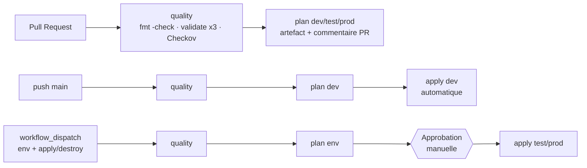

# Pipeline CI/CD

Fichier : [`.github/workflows/terraform.yml`](../.github/workflows/terraform.yml)

## Étapes obligatoires → implémentation

| # | Étape demandée | Implémentation |
|---|----------------|----------------|
| 1 | Récupérer le dépôt | `actions/checkout@v4` |
| 2 | Installer Terraform | `hashicorp/setup-terraform@v3` (version figée `TF_VERSION`) |
| 3 | Authentification sécurisée | `aws-actions/configure-aws-credentials@v4` : OIDC (`vars.AWS_*_ROLE_ARN`) sinon secrets chiffrés |
| 4 | `terraform fmt -check` | job `quality`, `-recursive` |
| 5 | `terraform init` | `-backend-config` (bucket en variable de dépôt) |
| 6 | `terraform validate` | les 3 environnements dans `quality`, puis dans chaque plan |
| 7 | `terraform plan` | `-out=tfplan -detailed-exitcode -lock-timeout=5m` |
| 8 | Conserver / publier le plan | artefact `tfplan-<env>` (tfplan + plan.txt, 5 jours), résumé du job, commentaire sur la PR |
| 9 | apply contrôlé test/prod | job `apply` lié au GitHub Environment ; *Required reviewers* sur test et prod ; applique **le fichier de plan relu** |

## Règles de sécurité du pipeline

- `apply` ne s'exécute **jamais** sur une Pull Request et uniquement sur `refs/heads/main`.
- prod : environnement GitHub avec *Required reviewers* et *Deployment branches = main* ; le rôle OIDC `apply` n'est assumable que depuis `environment:dev|test|prod`.
- `concurrency` par environnement : pas deux applies simultanés (en plus du verrou d'état).
- Aucun secret dans le YAML ; les valeurs des secrets sont masquées automatiquement dans les journaux.
- Permissions du `GITHUB_TOKEN` minimales (`contents: read`, `pull-requests: write`, `id-token: write`).

## Configuration à faire dans GitHub

1. **Settings → Secrets and variables → Actions**
   - Variables : `TF_STATE_BUCKET` (sortie `state_bucket` du bootstrap), `AWS_REGION` = `us-east-1`
   - OIDC (compte standard) : `AWS_PLAN_ROLE_ARN`, `AWS_APPLY_ROLE_ARN`
   - Learner Lab : secrets `AWS_ACCESS_KEY_ID`, `AWS_SECRET_ACCESS_KEY`, `AWS_SESSION_TOKEN` (à **renouveler à chaque session** du lab)
2. **Settings → Environments** : créer `dev`, `test`, `prod` ; sur `test` et `prod` cocher *Required reviewers* et limiter les branches à `main`.
3. **Settings → Branches** : protéger `main` (PR obligatoire, check `fmt & validate` requis, pas de push direct).

## Utilisation

- Ouvrir une PR → lire le plan commenté → fusionner → `dev` est déployé.
- *Actions → terraform → Run workflow* → choisir `test` + `apply` → approuver → déployé.
- Après la démo : *Run workflow* → `test` + `destroy` → approuver.
